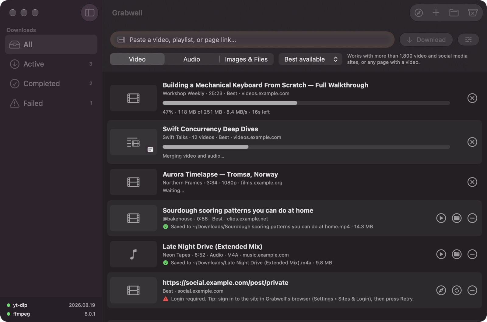
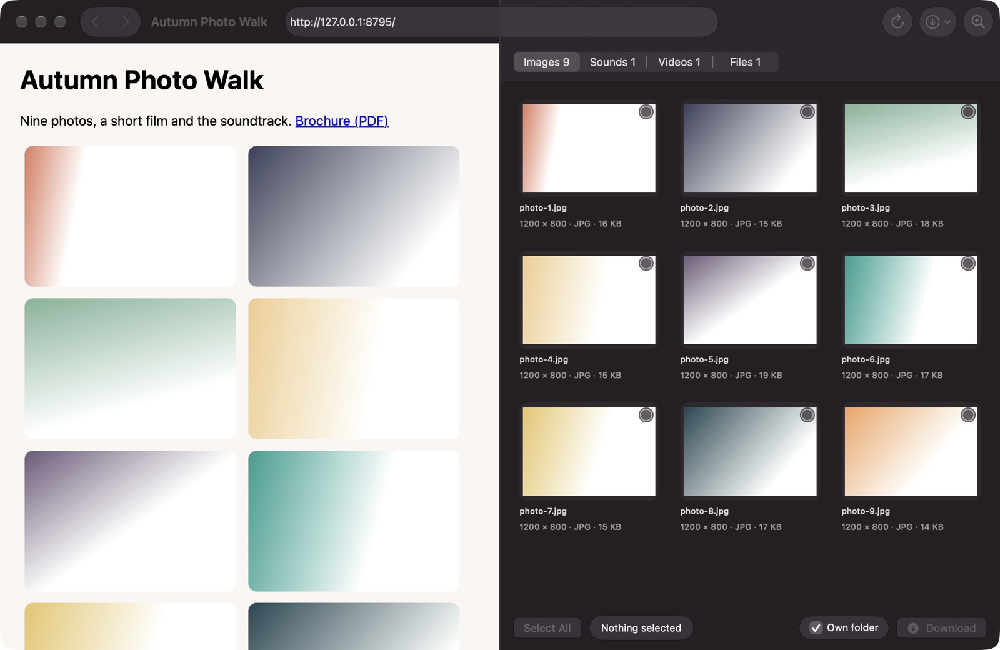

# Grabwell

Grabwell is a free Mac app that saves video, sound, images and files from web pages. Paste a link, choose what you want, and it lands in your Downloads folder.

## Download

**[Download Grabwell for Mac](https://github.com/perseus-sepahi/grabwell-app/releases/latest/download/Grabwell.dmg)** (free, about 4 MB)

Open the disk image and drag Grabwell into Applications. The app is signed with a Developer ID and notarized by Apple, so it opens without security warnings.

- macOS 14 Sonoma or newer, on Apple silicon or Intel Macs
- The Liquid Glass design appears on macOS 26 and newer

## What it does

- **Video.** Saves videos from more than 1,800 video and social media sites, in the quality you choose, as files that play in QuickTime.
- **Audio.** Saves just the sound of any video, music or podcast link, as MP3, M4A, Opus, FLAC or WAV.
- **Images and files.** Opens the page, finds its images, sounds, videos, PDFs and other files, and lets you pick what to save. Images are saved at full size.
- **Built-in browser.** Press play on a page and Grabwell catches the real link while it plays. Sign in to a site once in this browser, and downloads from that site use your login.
- **Keeps working.** Sites change often. Grabwell updates its download engine by itself and retries with a newer one when a site stops working.
- **A real Mac app.** A download queue with progress, retry and resume, playlists, drag and drop, and notifications.

## First launch

Grabwell uses two open-source tools: **yt-dlp** finds and downloads media, and **ffmpeg** joins video and audio and converts sound. On first launch Grabwell offers to install yt-dlp for you, about 37 MB. ffmpeg is optional and can be installed the same way from Settings › Tools. Grabwell also uses copies you already have, for example from Homebrew.

## Privacy

Grabwell has no account, no analytics and no tracking. It connects only to the pages you open, to the official release pages of yt-dlp and ffmpeg when it installs or updates them, and to Apple's notification service if you allow notifications. Logins you make in its browser stay on your Mac. They are shared with the download engine only for the download you start, through a private file that is deleted afterwards.

## Please use it fairly

Save only what you own or have permission to keep. Some sites' terms don't allow downloading, and saved videos stay protected by copyright. Videos protected with DRM can't be saved by Grabwell or any other downloader.

## Support

Found a bug or a page that won't download? [Open an issue](https://github.com/perseus-sepahi/grabwell-app/issues) with the link and what you expected. The Copy Diagnostic Log item in a download's right-click menu helps.

## Licence

Grabwell is free to download and use. See [LICENSE.md](LICENSE.md) for the terms and [THIRD-PARTY-NOTICES.md](THIRD-PARTY-NOTICES.md) for the open-source tools it works with.

Made by Perseus Sepahi.
